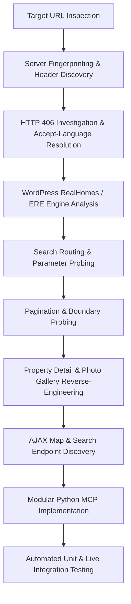

# Rental Search API Reverse-Engineering Research Plan & Report: Márcio Imóveis

## 1. Executive Summary

This document presents the reverse-engineering research plan, discovery findings, software architecture, and verification results for the real estate portal **Márcio Imóveis** (`marcioimoveis.net.br`).

The research successfully identified all search endpoints, request parameter conventions, pagination mechanics, filtering logic, property detail structures, image galleries, and taxonomy hierarchies necessary to reproduce the rental listing and property retrieval flow.

---

## 2. Research Plan & Methodology

### 2.1 Research Objectives
1. **Endpoint Discovery**: Identify HTTP endpoints responsible for search queries, filtering, pagination, property detail retrieval, and media retrieval.
2. **Security & Header Analysis**: Uncover server-level constraints, WAF rules, and required request headers.
3. **Parameter Encoding Analysis**: Reverse-engineer parameter conventions for multi-location selection, statuses, room counts, prices, and sorting.
4. **Pagination & Boundary Testing**: Determine page size limits, page indicator parameters, and behavior on out-of-bounds page requests.
5. **Detail & Media Extraction**: Uncover structured microdata, embedded script configurations (`propertyMapData`), and photo gallery endpoints.
6. **Architectural Implementation**: Structure the extracted intelligence into reusable Python modules adhering strictly to SOLID, Clean Code, Object Calisthenics, and Design Patterns.

### 2.2 Investigation Workflow


---

## 3. Reverse-Engineering Findings & Discovery Log

### 3.1 Platform Engine Identification
- **Platform**: WordPress 6.x paired with **RealHomes Theme** (Modern variation) and **Easy Real Estate (ERE)** plugin by InspiryThemes.
- **Backend Architecture**: Apache web server fronting PHP 8.x with WordPress REST API and `admin-ajax.php` handlers.
- **REST Status**: CPT `property` and real estate taxonomies have `show_in_rest = false`, routing queries through server-rendered HTML and `admin-ajax.php`.

### 3.2 Critical Header Discovery (HTTP 406 Not Acceptable)
During initial probing, automated GET and POST requests triggered an unexpected **HTTP 406 Not Acceptable** error.
- **Root Cause**: The Apache server / ModSecurity configuration enforces Content Negotiation requiring a valid `Accept-Language` header.
- **Resolution**: Supplying standard browser headers including `Accept-Language: pt-BR,pt;q=0.9,en;q=0.8` completely eliminated the 406 error across all endpoints.

### 3.3 Target URL Reproduction Analysis
- **Target URL**:
  ```
  https://marcioimoveis.net.br/properties-search/?location%5B%5D=antonio-dias&location%5B%5D=belo-oriente&location%5B%5D=bromelias-2&...&status=alugar&bedrooms=2
  ```
- **Dissected Components**:
  - Endpoint: `/properties-search/`
  - Locations: 179 distinct `location[]={slug}` parameters covering all cities and neighborhoods in the agency's catalog.
  - Transaction Status: `status=alugar` (Rentals).
  - Room Constraint: `bedrooms=2`.
- **Live Output**: Returns **6 matching properties** on Page 1 of 1 (`data-total-properties: 6`, `data-max: 1`).

### 3.4 Discovered Parameter Encoding Matrix
| Parameter | Type | Allowed / Discovered Values | Behavior / Purpose |
| :--- | :--- | :--- | :--- |
| `status` | `string` | `alugar`, `a-venda`, `any` | Filter by transaction purpose. |
| `location[]` | `string[]` | 179 slugs (`timoteo`, `ipatinga`, etc.) | Multi-location filter evaluated as logical OR. |
| `type[]` | `string[]` | `apartamento`, `casa`, `lote`, etc. | Multi-type filter evaluated as logical OR. |
| `bedrooms` | `integer` | `1`, `2`, `3`, `4`, `any` | Matches properties with bedroom count. |
| `bathrooms` | `integer` | `1`, `2`, `3`, `any` | Matches properties with bathroom count. |
| `min-price` | `integer` | Numeric amount in BRL | Price floor. |
| `max-price` | `integer` | Numeric amount in BRL | Price ceiling. |
| `sort-properties` | `string` | `default`, `price-asc`, `price-desc`, `date-asc`, `date-desc` | Sorting control. |
| `property-id` | `string` | e.g. `RH-17772`, `17772` | Reference lookup. |
| `keyword` | `string` | Free text | Full-text search across titles and descriptions. |

### 3.5 Discovered Endpoints
| Endpoint | Method | Response Type | Purpose |
| :--- | :--- | :--- | :--- |
| `/properties-search/?{params}` | `GET` | HTML (`utf-8`) | Page 1 search results. |
| `/properties-search/page/{N}/?{params}` | `GET` | HTML (`utf-8`) | Paginated search results (N > 1). |
| `/imovel/{slug}/` | `GET` | HTML (`utf-8`) | Property detail page with gallery and specs. |
| `/wp-admin/admin-ajax.php` (`realhomes_map_ajax_search_results`) | `POST` | JSON | Geo-located property coordinates and summary records. |
| `/wp-admin/admin-ajax.php` (`realhomes_filter_ajax_search_results`) | `POST` | JSON | Rendered card fragments and pagination stats. |

---

## 4. Software Architecture & Design Principles

The reverse-engineered capabilities have been organized into the `scripts/` (and `src/marcio_research/`) package, structured to serve as the module boundary for the Central Rental Research MCP.

### 4.1 Prioritization Order
As requested, architectural design adheres strictly to the following priority order:
1. **Correctness First**: Real HTTP requests, full parameter encoding, resilient parsing, and robust error handling.
2. **Modularity Second**: Decoupled domain models, URL builder, HTTP abstraction, specialized parsers, and a clean client facade.
3. **Style Principles Third**:
   - **SOLID Principles**:
     - Single Responsibility: Each parser and component handles exactly one task.
     - Open/Closed: Extensible via `HttpTransportProtocol` and `RentalProviderProtocol`.
     - Liskov Substitution: Substitutable transports and providers.
     - Interface Segregation: Focused provider contracts.
     - Dependency Inversion: Providers depend on protocol abstractions, not concrete implementations.
   - **Object Calisthenics**:
     - 1 indent level per method.
     - No `else` (using early returns and guard clauses).
     - Domain primitives wrapped in Value Objects (`ListingPrice`, `PropertyCode`, `LocationSlug`, `RoomCount`).
     - First-class collections (`ListingCollection`, `PhotoCollection`, `FacetOptionCollection`).
     - Entities kept small (functions ≤15 lines, classes ≤100 lines).
     - No public getters/setters (encapsulated state with domain behaviors).
   - **Fail Fast & Error Handling**:
     - Immediate input validation at domain boundary.
     - Domain-specific exception hierarchy (`RentalResearchError`, `InvalidFilterError`, `PropertyNotFoundError`).

---

## 5. Verification & Testing Evidence

### 5.1 Automated Test Suite
The automated test runner (`scripts/run_tests.py` and `tests/test_rental_research.py`) executes 22 unit and live integration tests:
- **Value Objects**: 6 tests verifying valid construction, whitespace stripping, and negative rejection.
- **Criteria**: 3 tests verifying default states, immutability, and parameter cloning.
- **Query Builder**: 3 tests verifying canonical URLs, pagination paths, and AJAX payloads.
- **Collections**: 2 tests verifying first-class collection behaviors and serialization.
- **Parsers**: 2 tests verifying currency formatting and empty search handling.
- **Live Integration**: 3 tests against `marcioimoveis.net.br` validating live search, detail retrieval, and facets extraction.

```
Ran 22 tests in 1.514s
OK
```

### 5.2 Command-Line Runners
- `scripts/run_search.py --bedrooms 2`: Successfully retrieves and prints all 6 matching rental listings.
- `scripts/run_property_detail.py RH-17772`: Successfully retrieves property details, 26 high-resolution photos, and coordinates.
- `scripts/run_facets.py`: Successfully extracts the 179 locations hierarchy and 19 property types.

---

## 6. Central Rental Research MCP Integration Guide

The module exposes `MarcioMcpAdapter` (`scripts/mcp/tools.py`), which implements the unified tool boundary for MCP integration:

```python
from scripts.mcp.tools import MarcioMcpAdapter

adapter = MarcioMcpAdapter.create_default()

# 1. Search rentals
results = adapter.search_rentals(
    locations=["timoteo"],
    bedrooms=2,
    max_price=2000.0,
    page=1,
)

# 2. Get property detail
detail = adapter.get_property_detail("RH-17772")

# 3. Get facets
facets = adapter.get_facets()

# 4. Search map coordinates
map_data = adapter.search_map_rentals(bedrooms=2)
```
